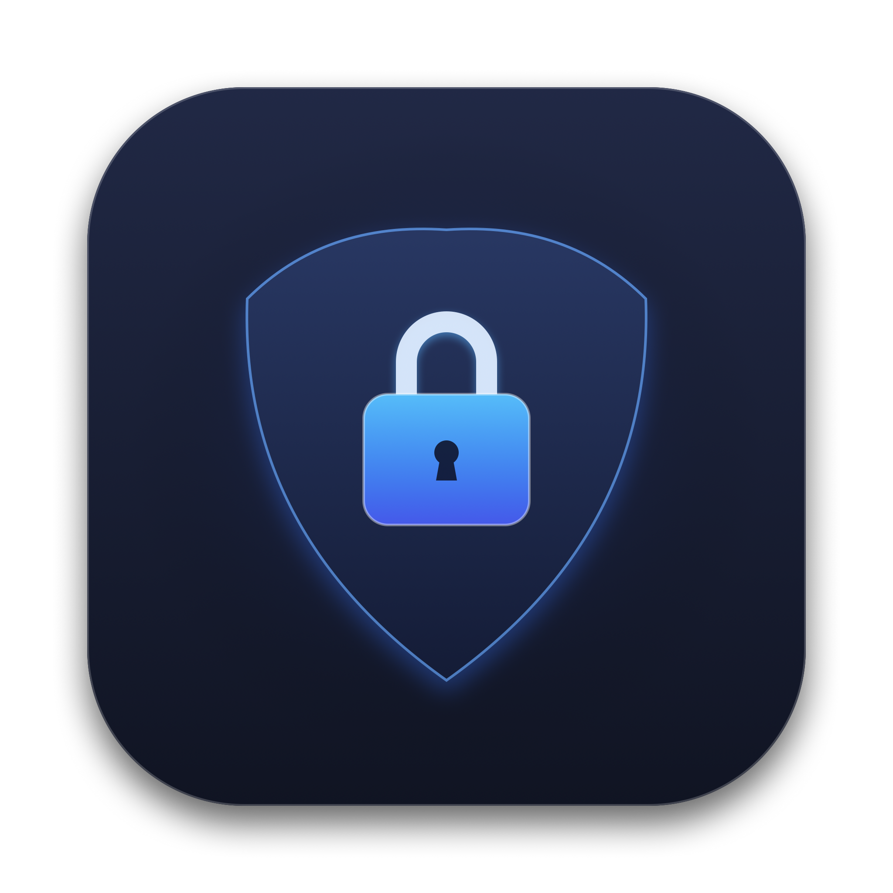

<p align="center">
  
</p>

<h1 align="center">GateKeeper</h1>

<p align="center">
  <strong>Native, secure, local App Locker for macOS written in Swift, SwiftUI, and AppKit.</strong>
</p>

<p align="center">
  
  
  
  
  
</p>

---

## 🔒 Overview

**GateKeeper** is a native macOS menu-bar utility that locks installed applications behind biometric authentication (Touch ID) or a master passcode. When a locked application is launched or brought into the foreground, GateKeeper instantly intercepts it with a full-screen, high-priority frosted-glass lock screen, completely blocking unauthorized viewing and interaction.

Built with **100% native Apple frameworks** (AppKit, SwiftUI, LocalAuthentication, Security, CryptoKit, and ApplicationServices), GateKeeper requires zero third-party dependencies and runs locally on your Mac.

---

## ✨ Features

- **Menu Bar Status Item UI:**
  - Operates as a background agent (`LSUIElement = true` / `NSApp.setActivationPolicy(.accessory)`).
  - Sleek lock icon in the macOS status bar.
  - Interactive popover dashboard with live search, filters (All / Locked / Unlocked), and quick toggle switches.
  - Global Protection switch to pause or resume locking on demand.

- **Real-Time App Monitoring Engine:**
  - Listens to `NSWorkspace.didActivateApplicationNotification`, `NSWorkspace.didLaunchApplicationNotification`, and `NSWorkspace.didDeactivateApplicationNotification`.
  - Instantly checks frontmost bundle identifiers against a persisted restricted app list.
  - Supports configurable relocking policies:
    - *Immediately on switch* (locks whenever switching away from the app)
    - *After 1 minute*, *After 5 minutes*, or *After 15 minutes* of inactivity.

- **Interception & Full-Screen Lock Overlay:**
  - High-priority floating window (`NSPanel` at `.screenSaver` window level) that floats above all apps, full-screen spaces, and system UI.
  - Heavy frosted-glass blur (`NSVisualEffectView` with `.fullScreenUI`).
  - Hides the target app (`app.hide()`) immediately upon activation to prevent sensitive contents from leaking before verification.
  - Displays the locked application's high-resolution icon, app title, and bundle identifier.
  - On cancel or failure, pushes the locked app to the background and restores focus to Finder.

- **Biometrics & Hardware Security:**
  - Automatic Touch ID / Apple Watch biometric authentication prompt via `LocalAuthentication` (`LAContext`).
  - Fallback to secure master passcode.
  - Passcode is hashed using **SHA-256** with a cryptographically secure random salt and stored in the **macOS Keychain Services** (`kSecClassGenericPassword`).

- **Permissions & First-Launch Onboarding:**
  - Step-by-step onboarding guide on first launch.
  - Accessibility status detection (`AXIsProcessTrusted()`) with one-click shortcut to macOS System Settings (`Privacy & Security -> Accessibility`).

---

## 🏗️ Architecture & Project Structure

```
GateKeeper/
├── GateKeeper.xcodeproj/          # Native Xcode project
├── Package.swift                  # Swift Package Manager manifest
├── build.sh                       # Automation build & code-signing script
├── Resources/
│   ├── AppIcon.icns               # Generated macOS ICNS icon
│   ├── AppIcon_1024.png           # 1024x1024 Master Icon
│   ├── Assets.xcassets/           # Asset catalog with multi-resolution icons
│   ├── Info.plist                 # Agent bundle configuration (LSUIElement = true)
│   └── GateKeeper.entitlements    # macOS runtime entitlements
└── Sources/
    └── GateKeeper/
        ├── App/
        │   ├── GateKeeperApp.swift         # @main SwiftUI App entry point
        │   └── AppDelegate.swift           # NSStatusItem & NSPopover management
        ├── Core/
        │   ├── WorkspaceMonitor.swift      # Real-time NSWorkspace event interceptor
        │   ├── AuthManager.swift           # Touch ID & Passcode coordinator
        │   ├── KeychainHelper.swift        # macOS Keychain operations & salted SHA-256
        │   ├── AppScanner.swift            # Discovers apps in /Applications & ~/Applications
        │   └── AccessibilityManager.swift  # AXIsProcessTrusted() monitoring
        ├── Models/
        │   └── InstalledApp.swift          # Model representing installed applications
        ├── Overlay/
        │   ├── LockOverlayController.swift # NSPanel (.screenSaver level) presenter
        │   └── LockOverlayView.swift       # Frosted glass lock screen UI & biometrics
        └── UI/
            ├── DashboardView.swift         # Status bar popover dashboard
            ├── PasscodeModalView.swift     # Set/Change master passcode sheet
            ├── OnboardingView.swift        # First-run permissions & setup sheet
            └── Components/
                └── AppRowView.swift        # Application list row with lock toggle
```

---

## 🚀 Building & Running

### Option 1: Command Line Build (Recommended)
You can compile and assemble the signed `.app` bundle with a single command:
```bash
./build.sh
```
This produces `build/GateKeeper.app`. You can launch it immediately:
```bash
open build/GateKeeper.app
```

### Option 2: Swift Package Manager
```bash
swift build -c release
```

### Option 3: Xcode
Double-click `GateKeeper.xcodeproj` to open it in Xcode, select the `GateKeeper` scheme, and hit **Cmd + R** to run.

---

## ⚙️ Requirements

- macOS 13.0 (Ventura) or later (Sonoma, Sequoia, etc.)
- Xcode 15.0+ / Swift 5.9+
- Accessibility permissions enabled in **System Settings > Privacy & Security > Accessibility**

---

## 🛡️ License

MIT License. Designed and crafted for macOS security.
